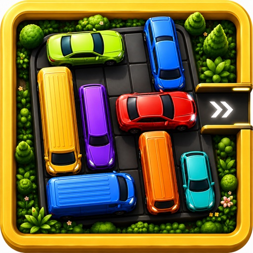
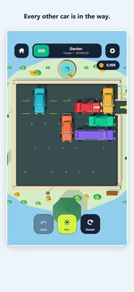
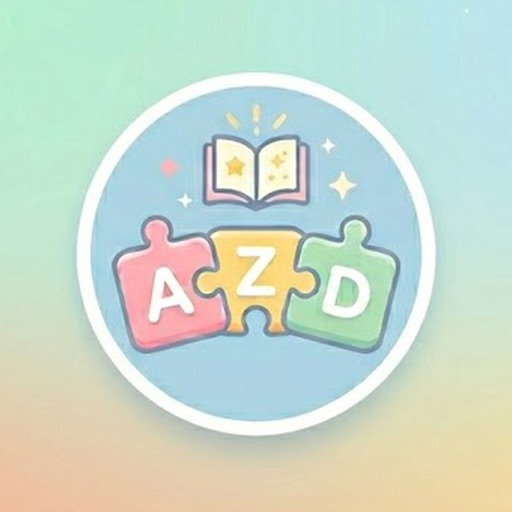
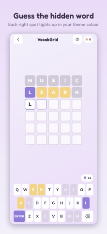
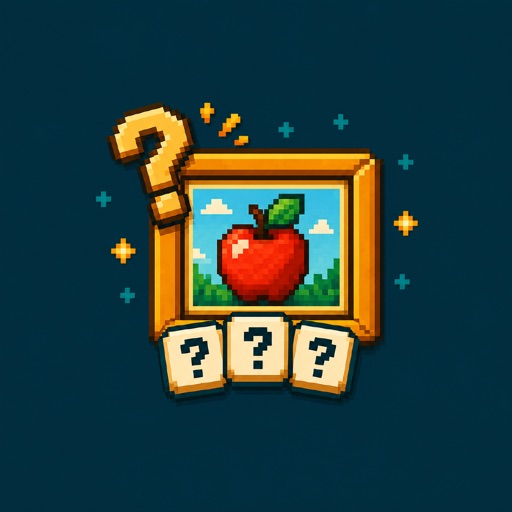

  

I design and build mobile puzzle games, from gameplay and level progression to implementation and publishing. My background is in Artificial Intelligence at **UET, Vietnam National University, Hanoi**.

**Hanoi, Vietnam** · [Email](mailto:totenhaibang@gmail.com) · [All Android apps](https://play.google.com/store/apps/developer?id=Hablabs) · [All iOS apps](https://apps.apple.com/ua/developer/nguyen-duy-hai-bang/id6786131027)

## Featured games

<table>
  <tr>
    <td width="50%" valign="top">
      
      <h3>Let the car out!</h3>
      
A sliding-block puzzle. Move the other vehicles and find a clear path for the target car.

      

      
<strong>My work</strong> Game design and development; level generation and verification; a 19,103-level campaign; tutorials, star ratings, hints and chapter progression.

      
Unity · C# · Python

      
<a href="https://apps.apple.com/app/id6802072718"><strong>App Store ↗</strong></a> &nbsp; · &nbsp; <a href="https://play.google.com/store/apps/details?id=com.hablabs.letthecarout"><strong>Google Play ↗</strong></a>

    </td>
    <td width="50%" valign="top">
      
      <h3>Vocab Games</h3>
      
A collection of word puzzles: guess words, connect letters, solve word ladders and build your vocabulary.

      

      
<strong>My work</strong> 10 game modes; difficulty settings, daily puzzles, streaks and word collections; hint systems, rewarded-ad integration and in-app purchases.

      
Flutter · Dart

      
<a href="https://apps.apple.com/app/id6786131025"><strong>App Store ↗</strong></a> &nbsp; · &nbsp; <a href="https://play.google.com/store/apps/details?id=com.vocabgames.vocab_games"><strong>Google Play ↗</strong></a>

    </td>
  </tr>
</table>

### Guess The Pictures

An offline picture-word puzzle: identify the picture, spell the word and learn its meaning. Built with **Flutter and Dart**, with hints, saved progress and a vocabulary collection.

[App Store ↗](https://apps.apple.com/app/id6799332250)

 

## Other puzzle projects

| Project | Design focus | Tools |
| --- | --- | --- |
| **FlowDoku** | 1,000 uniquely solvable flower logic puzzles, estimated difficulty ranking and interactive onboarding. | Flutter, Dart, Python, C++ |
| **Let it flow!** | Pipe rotation puzzles, deterministic level generation, unique-solution checks and hint progression. | Flutter, Dart |

## AI & technical work

**FPGA-Based Ship Detection in SAR Satellite Imagery** — Graduation thesis, 2026.

Deployed an INT8-quantized YOLOv5n model on a Xilinx ZCU106 with DPU acceleration. Built a PetaLinux/Vitis AI environment and a three-stage asynchronous processing pipeline; proposed land–sea masking for the detection workflow.

**AI Engineer Intern · Institute of Military Science and Technology** — Sep–Dec 2025.

Built a financial document dataset and trained a Key Information Extraction model to produce structured JSON.

## Toolkit

**Game design:** gameplay mechanics, level design, progression, difficulty balancing, tutorials and hint economies.  
**Development:** Unity, C#, Flutter, Dart, Python, C++, JavaScript, Git/GitHub and Docker.  
**AI:** machine learning, LLM/API integration, prompt design, LangChain and AutoGen.

## Education & recognition

- **Bachelor’s Degree in Artificial Intelligence**, UET – VNU Hanoi, 2026. Graduated with Distinction.
- **AI in Action**, VinUniversity, Jul–Oct 2026.
- **Third Prize**, IAI Hackathon 2025 and UET Code Camp 2025.
- **Academic Merit Scholarship**, Semester 1, 2025–2026.

---

Have a game design or development opportunity? [Get in touch](mailto:totenhaibang@gmail.com).
