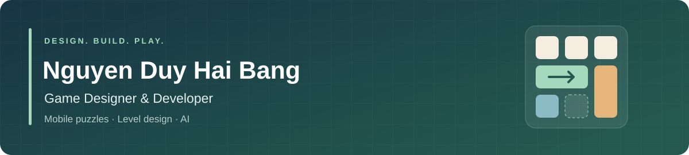

  

Hi, I'm **Bang**, an AI student at **UET, VNU Hanoi**. I'm interested in AI engineering and enjoy building things on the side, from AI experiments and small tools to mobile apps and games.

**Hanoi, Vietnam** · [Email](mailto:totenhaibang@gmail.com) · [Google Play](https://play.google.com/store/apps/developer?id=Hablabs) · [App Store](https://apps.apple.com/ua/developer/nguyen-duy-hai-bang/id6786131027)

## A few side projects

| Project | About | Try it |
| --- | --- | --- |
| **Let the car out!** | A mobile sliding-block puzzle. | [Google Play](https://play.google.com/store/apps/details?id=com.hablabs.letthecarout) · [App Store](https://apps.apple.com/app/id6802072718) |
| **Vocab Games** | A collection of word and vocabulary games. | [Google Play](https://play.google.com/store/apps/details?id=com.vocabgames.vocab_games) · [App Store](https://apps.apple.com/app/id6786131025) |
| **Guess The Pictures** | An offline picture-word puzzle. | [App Store](https://apps.apple.com/app/id6799332250) |

I also experiment with document information extraction, LLM-based tools, and AI on embedded hardware.

## Things I work with

Python, C++, C#, Flutter, Unity, Docker, Git, and LLM APIs.
